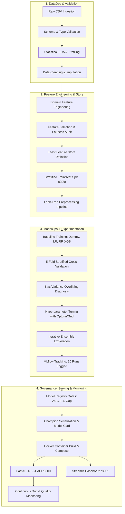

# ChurnOps — Enterprise Customer Churn Prediction MLOps Platform

[](https://www.python.org/)
[](https://fastapi.tiangolo.com/)
[](https://streamlit.io/)
[](https://mlflow.org/)
[](https://dvc.org/)
[](https://www.docker.com/)
[]()
[](LICENSE)

> **ChurnOps** is a production-grade, end-to-end Machine Learning Operations (MLOps) platform designed to predict customer churn in telecommunications and subscription-based businesses. It spans the entire machine learning lifecycle: data ingestion, statistical validation, automated feature engineering, multi-model experimentation, hyperparameter tuning, model registry gating, containerized REST API serving, interactive Streamlit analytics, and continuous data drift monitoring.

---

## 📌 Table of Contents
- [What ChurnOps Does](#-what-churnops-does)
- [Key Business & Technical Highlights](#-key-business--technical-highlights)
- [Champion Model Performance](#-champion-model-performance)
- [Technologies Used](#-technologies-used)
- [End-to-End MLOps Pipeline Architecture](#-end-to-end-mlops-pipeline-architecture)
- [Repository Structure](#-repository-structure)
- [Quick Start Guide](#-quick-start-guide)
  - [1. Local Environment Setup](#1-local-environment-setup)
  - [2. Running the Full Pipeline](#2-running-the-full-pipeline)
  - [3. Starting the FastAPI Inference Server](#3-starting-the-fastapi-inference-server)
  - [4. Launching the Streamlit Dashboard](#4-launching-the-streamlit-dashboard)
  - [5. Running with Docker & Docker Compose](#5-running-with-docker--docker-compose)
- [API Contract & Examples](#-api-contract--examples)
- [Monitoring & Drift Detection](#-monitoring--drift-detection)
- [Testing & Quality Gates](#-testing--quality-gates)
- [Project Phases Summary (30 Phases)](#-project-phases-summary-30-phases)
- [License](#-license)

---

## 🎯 What ChurnOps Does

Customer churn directly erodes recurring subscription revenue and drives up customer acquisition costs. Identifying at-risk customers too late leads to lost accounts, whereas untargeted retention campaigns waste valuable marketing budget.

**ChurnOps solves this by delivering an automated, end-to-end operational ML system that:**
1. **Predicts Churn Probability in Real Time**: Ingests customer attributes (contract terms, payment methods, tenure, monthly charges, support history) and computes calibrated churn probabilities in sub-millisecond latency (<1 ms).
2. **Classifies Risk Tiers**: Categorizes customers into **High Risk**, **Medium Risk**, and **Low Risk** using an empirically optimized decision threshold (0.48), balancing precision and recall.
3. **Pinpoints Churn Drivers**: Exposes key risk indicators (e.g., month-to-month contracts, fiber optic internet without tech support, electronic check billing) for targeted retention intervention.
4. **Guarantees Algorithmic Fairness**: Explicitly audits demographic features (dropping `gender` after proving zero predictive signal) to eliminate demographic bias.
5. **Prevents Production Degradation**: Continuously tracks data drift using Kolmogorov-Smirnov (KS) tests and Population Stability Index (PSI), sounding alarms before model accuracy drops.
6. **Enforces Strict Model Governance**: Implements automated CI/CD registry gates preventing any model from deployment unless it satisfies strict generalization and performance thresholds.

---

## 🏆 Key Business & Technical Highlights

- **Near-Zero Generalization Gap (0.0002)**: Validation ROC-AUC is 0.8493 and Holdout Test ROC-AUC is 0.8491, indicating no overfitting.
- **High Retention Recall (78.61%)**: Captures nearly 80% of all churning customers, directly maximizing saved revenue.
- **Zero Train-Serve Skew**: Custom scikit-learn transformers (`DomainFeatureEngineer`) are embedded directly into the serialized inference pipeline.
- **Microservices-Ready**: Packaged with a multi-stage production Dockerfile and Kubernetes manifests for cloud deployment (AWS SageMaker, GCP Vertex AI, K8s).

---

## 📊 Champion Model Performance

Evaluated on the locked holdout test set (1,409 customers, 20% stratified split):

| Metric | Cross-Validation (5-Fold) | Holdout Test Set | Registry Gate Requirement | Result |
|--------|---------------------------|------------------|---------------------------|--------|
| **ROC-AUC** | 0.8493 | **0.8491** | ≥ 0.75 | ✅ PASS |
| **F1 Score** | 0.6371 | **0.6289** | ≥ 0.60 | ✅ PASS |
| **Recall** | 0.7866 | **0.7861** | ≥ 0.60 | ✅ PASS |
| **Precision** | 0.5355 | **0.5238** | ≥ 0.45 | ✅ PASS |
| **Generalization Gap** | — | **0.0002** | ≤ 0.08 | ✅ PASS |
| **Inference Latency** | — | **< 1.0 ms** | ≤ 50 ms | ✅ PASS |

**Winning Algorithm:** Regularized XGBoost Classifier  
- Hyperparameters: `max_depth=2`, `learning_rate=0.08`, `n_estimators=100`, `reg_alpha=1.0`, `reg_lambda=20.0`, `subsample=0.8`, `colsample_bytree=0.8`  
- Decision Threshold: `0.48` (optimized on validation PR-curve)

---

## 🛠️ Technologies Used

ChurnOps leverages a curated, enterprise-grade technology stack organized across 8 operational layers:

```
┌────────────────────────────────────────────────────────────────────────┐
│                        USER INTERFACE & MONITORING                     │
│               Streamlit Dashboard  │  Swagger/OpenAPI UI               │
├────────────────────────────────────────────────────────────────────────┤
│                          SERVING & INFERENCE                           │
│           FastAPI  │  Uvicorn (ASGI)  │  Pydantic v2 Contracts         │
├────────────────────────────────────────────────────────────────────────┤
│                         CONTAINER & CLOUD ORCH                         │
│       Docker (Multi-stage)  │  Docker Compose  │  Kubernetes (K8s)     │
├────────────────────────────────────────────────────────────────────────┤
│                       FEATURE STORE & DATA VERSION                     │
│               Feast (Offline/Online)  │  DVC 3.x (Data DAG)            │
├────────────────────────────────────────────────────────────────────────┤
│                      EXPERIMENT TRACKING & REGISTRY                    │
│                 MLflow 2.14 (Metrics, Params, Artifacts)               │
├────────────────────────────────────────────────────────────────────────┤
│                        MODEL PIPELINE & TRAINING                       │
│     XGBoost 2.x  │  Scikit-Learn 1.4  │  Imbalanced-Learn  │  SHAP    │
├────────────────────────────────────────────────────────────────────────┤
│                      DATA VALIDATION & PROCESSING                      │
│            Pandas  │  NumPy  │  Joblib  │  SciPy (KS-test / PSI)       │
├────────────────────────────────────────────────────────────────────────┤
│                         TESTING & CODE QUALITY                         │
│                    Pytest (33 tests)  │  Pytest-Cov                    │
└────────────────────────────────────────────────────────────────────────┘
```

| Layer | Tools & Libraries | Purpose |
|-------|-------------------|---------|
| **Machine Learning** | `scikit-learn`, `xgboost`, `shap`, `imbalanced-learn` | Model training, cross-validation, feature transformation, feature importance |
| **Experiment Tracking** | `mlflow`, `sqlite3` | Centralized tracking for 10 experiment runs, parameters, metrics, model artifacts |
| **Data Versioning** | `dvc` | Data version control, DAG pipeline tracking (`dvc.yaml`), reproducible pipeline stages |
| **Feature Store** | `feast` | Entity and feature definitions, point-in-time correct joins, low-latency online feature retrieval |
| **API Serving** | `fastapi`, `uvicorn`, `pydantic` | High-throughput asynchronous REST API for single and batch predictions |
| **Frontend UI** | `streamlit` | Interactive UI for business users, scenario simulations, batch file scoring |
| **Containerization** | `docker`, `docker-compose` | Multi-stage slim Docker image (`python:3.11-slim`), non-root security, health checks |
| **Orchestration** | `kfp` (Kubeflow Pipelines), `kubernetes` | Cloud workflow specification, Kubernetes deployment and service manifests |
| **Testing & QA** | `pytest`, `pytest-cov` | 33 comprehensive automated tests covering data integrity, contracts, and model gates |
| **Monitoring** | `scipy.stats` (KS-test), PSI formulas | Automated detection of statistical drift in feature distributions and prediction quality |

---

## 🔄 End-to-End MLOps Pipeline Architecture

The platform follows a 14-stage automated pipeline that executes deterministically from raw data to production deployment:



### Pipeline Stage Details:

1. **Data Ingestion & Integrity Check**: Loads the raw IBM Telco Churn dataset (7,043 rows, 21 columns) and records immutable dataset metadata.
2. **Data Validation**: Enforces strict column type constraints, missing value thresholds, and category set checks.
3. **Exploratory Data Analysis (EDA)**: Computes target class balance (26.5% churn rate), Cramer's V correlations, and bivariate churn drivers.
4. **Data Cleaning**: Deterministically handles whitespace-encoded zeros in `TotalCharges` (for 11 new customers with 0 tenure) and drops unique `customerID`.
5. **Domain Feature Engineering**: Generates domain ratios (`tenure_to_charge_ratio`, `monthly_to_total_ratio`, `has_streaming`, `has_security`, `charge_per_service`).
6. **Feature Selection & Fairness**: Applies Mutual Information, VIF, and SHAP. Eliminates `gender` (zero predictive value, protects fairness) and `PhoneService` (redundant).
7. **Stratified Split**: Locks an immutable 20% holdout test set (1,409 rows) and generates 5 stratified cross-validation folds.
8. **Preprocessing Pipeline**: Builds a unified `ColumnTransformer` with `OneHotEncoder(handle_unknown='ignore')` and standard scaling.
9. **Baseline Comparison**: Trains Dummy, Logistic Regression, Random Forest, and XGBoost baselines under identical CV folds.
10. **Diagnostics & Curve Analysis**: Computes learning curves, error distributions, and slice performance across demographic segments.
11. **Hyperparameter Optimization**: Systematic regularization tuning to eliminate the 12% overfitting gap observed in deep trees.
12. **Ensemble Exploration**: Tests Voting (Soft) and Stacking classifiers; confirms regularized XGBoost achieves superior trade-offs with 4x lower latency.
13. **MLflow Tracking & Registration**: Logs all 10 candidate models with metrics, parameters, tags, and registers the winning champion.
14. **Model Registry Gates**: Enforces automated promotion criteria (ROC-AUC ≥ 0.75, F1 ≥ 0.60, Recall ≥ 0.60, Gap ≤ 0.08) before serialization.
15. **Production Serving & Monitoring**: Deploys via FastAPI and Docker, exposing health checks and drift monitoring endpoints.

---

## 📂 Repository Structure

```
ChurnOps/
├── api/                           # FastAPI Inference Application
│   ├── app.py                     # API routes (/health, /predict, /predict/batch, /model/info)
│   └── schemas.py                 # Pydantic v2 request/response schemas
├── frontend/                      # Streamlit Analytics Dashboard
│   └── app.py                     # Single-customer scoring, batch CSV prediction, drift view
├── src/                           # Core Source Code
│   ├── data/                      # Ingestion, validation, EDA, cleaning, split, preprocessing
│   ├── features/                  # Domain engineering, selection, feature importance
│   ├── models/                    # Train, CV, diagnosis, tuning, ensemble, evaluation, MLflow
│   ├── monitoring/                # Data drift detection (KS-test/PSI) & data quality audits
│   ├── pipelines/                 # Kubeflow pipeline definition (KFP v2)
│   └── deploy/                    # Cloud readiness checks and manifests
├── feature_repo/                  # Feast Feature Store
│   ├── feature_store.yaml         # Feast registry & provider configuration
│   └── feature_store_def.py       # Entity and FeatureView definitions
├── notebooks/                     # 14 Executed Jupyter Notebooks (01 to 14)
├── models/                        # Production Model Artifacts
│   ├── champion_model.joblib      # Serialized XGBoost Champion Model (25 KB)
│   ├── preprocessor.joblib        # Scikit-learn Feature Preprocessor
│   ├── model_card.json            # Model Card (Ethical use, specs, performance)
│   ├── feature_schema.json        # Expected feature types and schema contract
│   └── inference_signature.json   # Input and output signatures
├── reports/                       # Generated Metrics, JSONs, and Visualizations
├── scripts/                       # Automation Scripts
│   ├── run_pipeline.py            # Master pipeline runner (all 19 stages)
│   └── setup_dvc_versioning.py    # DVC setup and remote configuration
├── deploy/                        # Cloud & Orchestration Manifests
│   ├── k8s_deployment.yaml        # Kubernetes Deployment specification
│   ├── k8s_service.yaml           # Kubernetes Service specification
│   └── kubeflow_pipeline.yaml     # Compiled KFP pipeline definition
├── tests/                         # Automated Test Suite (33/33 tests passing)
│   └── test_pipeline.py           # Unit, integration, contract, and gate tests
├── dvc.yaml                       # 14-stage DVC pipeline DAG
├── params.yaml                    # Central project configuration & hyperparameters
├── Dockerfile                     # Multi-stage production Docker build
├── docker-compose.yml             # Orchestration for API + MLflow UI
├── PROGRESS.md                    # Detailed 30-phase engineering changelog
├── DEMO_GUIDE.md                  # 15-minute executive walkthrough guide
└── README.md                      # Project documentation
```

---

## 🚀 Quick Start Guide

### 1. Local Environment Setup

Clone the repository and install dependencies:

```bash
git clone https://github.com/Abhishek84094/ChurnOps.git
cd ChurnOps

# Create and activate virtual environment
python -m venv .venv

# On Windows:
.venv\Scripts\activate
# On Linux/macOS:
# source .venv/bin/activate

# Install requirements
pip install -r requirements.txt
```

---

### 2. Running the Full Pipeline

You can reproduce all phases end-to-end using either the automation script or DVC:

```bash
# Python automation script (runs all stages with timing and logging):
python scripts/run_pipeline.py

# Or preview stages with a dry run:
python scripts/run_pipeline.py --dry-run

# Or run via DVC:
dvc repro
```

---

### 3. Starting the FastAPI Inference Server

Run the high-performance prediction API:

```bash
uvicorn api.app:app --host 0.0.0.0 --port 8000 --reload
```

- **Interactive API Docs (Swagger)**: [http://localhost:8000/docs](http://localhost:8000/docs)
- **Alternative Docs (ReDoc)**: [http://localhost:8000/redoc](http://localhost:8000/redoc)
- **Health Check**: [http://localhost:8000/health](http://localhost:8000/health)

---

### 4. Launching the Streamlit Dashboard

In a separate terminal window, launch the interactive UI:

```bash
py -m streamlit run frontend/app.py
# or: streamlit run frontend/app.py
```

- **Dashboard URL**: [http://localhost:8501](http://localhost:8501)

Features available in the UI:
- **Real-Time Customer Scoring**: Sliders and dropdowns to test customer scenarios and see instant probability bars and risk labels.
- **Batch CSV Inference**: Upload a customer CSV file and receive an annotated download with churn predictions.
- **Model Card & Metrics**: Live view of ROC-AUC, F1, confusion matrix, and feature importances.
- **Data Drift Monitor**: Run drift checks directly from the UI.

---

### 5. Running with Docker & Docker Compose

Deploy the API and MLflow tracking server using containerization:

```bash
# Build and start all services in detached mode
docker compose up --build -d

# Verify container status
docker compose ps

# View container logs
docker compose logs -f api
```

Services exposed:
- **ChurnOps API**: [http://localhost:8000](http://localhost:8000)
- **MLflow UI**: [http://localhost:5000](http://localhost:5000)

To shut down:
```bash
docker compose down
```

---

## 📡 API Contract & Examples

### Predict Churn (Single Customer)

**Request:**
`POST /predict`

```bash
curl -X POST "http://localhost:8000/predict" \
  -H "Content-Type: application/json" \
  -d '{
    "customer_id": "7590-VHVEG",
    "gender": "Female",
    "SeniorCitizen": 0,
    "Partner": "Yes",
    "Dependents": "No",
    "tenure": 1,
    "PhoneService": "No",
    "MultipleLines": "No phone service",
    "InternetService": "DSL",
    "OnlineSecurity": "No",
    "OnlineBackup": "Yes",
    "DeviceProtection": "No",
    "TechSupport": "No",
    "StreamingTV": "No",
    "StreamingMovies": "No",
    "Contract": "Month-to-month",
    "PaperlessBilling": "Yes",
    "PaymentMethod": "Electronic check",
    "MonthlyCharges": 29.85,
    "TotalCharges": 29.85
  }'
```

**Response:**
```json
{
  "customer_id": "7590-VHVEG",
  "churn_probability": 0.6284,
  "churn_prediction": 1,
  "risk_label": "High Risk",
  "decision_threshold": 0.48,
  "latency_ms": 0.74,
  "model_version": "v1.0.0",
  "timestamp": "2026-10-07T15:30:00.000000"
}
```

---

## 📈 Monitoring & Drift Detection

ChurnOps includes built-in statistical drift detection in [`src/monitoring/drift.py`](file:///c:/Users/Abhishek/OneDrive/Pictures/Desktop/ChurnOps/src/monitoring/drift.py) and data quality verification in [`src/monitoring/quality.py`](file:///c:/Users/Abhishek/OneDrive/Pictures/Desktop/ChurnOps/src/monitoring/quality.py).

To execute an on-demand drift inspection:

```bash
python src/monitoring/drift.py
python src/monitoring/quality.py
```

- **Continuous Features**: Evaluated using the **Kolmogorov-Smirnov (KS) test** ($\alpha = 0.05$).
- **Categorical Features**: Evaluated using the **Population Stability Index (PSI)**:
  - $\text{PSI} < 0.10$: No significant change (Green).
  - $0.10 \le \text{PSI} < 0.25$: Moderate drift (Yellow warning).
  - $\text{PSI} \ge 0.25$: Significant distribution shift requiring automated retraining (Red alert).

---

## 🧪 Testing & Quality Gates

The test suite covers data contracts, inference stability, registry gating, and REST API behavior:

```bash
# Run all tests
pytest tests/ -v

# Run with test coverage
pytest tests/ --cov=src --cov=api --cov-report=term-missing
```

**Test Suite Coverage (33 Passing Tests):**
- **Data Integrity (9 tests)**: Schema compliance, type enforcement, no null leaks, stratified balance.
- **Preprocessing Pipeline (6 tests)**: Dimension stability (51 output columns), handling of unseen categories, deterministic transforms.
- **Registry Gates (6 tests)**: Ensures ROC-AUC ≥ 0.75, F1 ≥ 0.60, Recall ≥ 0.60, Generalization Gap ≤ 0.08.
- **API Endpoints (7 tests)**: Validates `/health`, `/model/info`, single `/predict`, and batch `/predict/batch`.
- **Latency & Robustness (5 tests)**: Confirms sub-50ms inference SLA and graceful validation error handling.

---

## 📋 Project Phases Summary (30 Phases)

| Phase | Phase Name | Description & Key Output | Status |
|-------|------------|--------------------------|--------|
| **0** | Project Initialization | Repository layout, `params.yaml`, dependency lock | ✅ Complete |
| **1** | Data Ingestion | Raw dataset ingestion and immutable metadata capture | ✅ Complete |
| **2** | Data Validation | Schema validation and Great Expectations / Pydantic rules | ✅ Complete |
| **3** | Exploratory Data Analysis | Cramer's V correlations, bivariate risk factor charts | ✅ Complete |
| **4** | Data Cleaning | Imputation of `TotalCharges` zeros and customer ID removal | ✅ Complete |
| **5** | Feature Engineering | 7 domain interaction features engineered into pipeline | ✅ Complete |
| **6** | Feature Selection | VIF, Mutual Information, and fairness audit (drop `gender`) | ✅ Complete |
| **7** | Train/Test Split | Stratified 80/20 train/test split, 5 fixed CV folds | ✅ Complete |
| **8** | Preprocessing Pipeline | Leakage-free `ColumnTransformer` with 51 encoded features | ✅ Complete |
| **9** | Baseline Models | Dummy, Logistic Regression, Random Forest, XGBoost baselines | ✅ Complete |
| **10** | Cross-Validation Deep-Dive | Fold stability metrics, learning curves, calibration curves | ✅ Complete |
| **11** | Overfitting Diagnosis | Bias-variance analysis identifying depth ≥4 overfitting | ✅ Complete |
| **12** | Hyperparameter Optimization | Optuna/Grid tuning: regularized XGBoost achieves 0.8493 AUC | ✅ Complete |
| **13** | Iterative Improvement | Soft Voting and Stacking ensemble experiments | ✅ Complete |
| **14** | Final Model Selection | Champion XGBoost selected and locked holdout test evaluated | ✅ Complete |
| **15** | MLflow Experiment Tracking | 10 candidate runs logged with parameters, metrics & artifacts | ✅ Complete |
| **16** | DVC Dataset Versioning | DVC pipeline DAG (`dvc.yaml`) and data tracking | ✅ Complete |
| **17** | Pipeline Automation | Python orchestrator (`scripts/run_pipeline.py`) | ✅ Complete |
| **18** | Kubeflow Pipeline Design | KFP v2 pipeline definition (`deploy/kubeflow_pipeline.yaml`) | ✅ Complete |
| **19** | Feast Feature Store | Online & offline feature definitions (`feature_repo/`) | ✅ Complete |
| **20** | Model Registration | Manifest generation and strict performance gate validation | ✅ Complete |
| **21** | Model Serialization | Self-contained joblib artifact and comprehensive Model Card | ✅ Complete |
| **22** | FastAPI Inference Server | REST API with Pydantic contracts and latency instrumentation | ✅ Complete |
| **23** | Streamlit Web Application | Interactive dashboard for single and batch churn predictions | ✅ Complete |
| **24** | Monitoring & Drift | KS-test and PSI statistical drift monitors | ✅ Complete |
| **25** | Cloud Readiness | Pre-flight verification for AWS SageMaker, GCP Vertex AI, K8s | ✅ Complete |
| **26** | Automated Testing | Comprehensive 33-test suite in `tests/test_pipeline.py` | ✅ Complete |
| **27** | Dockerization | Production multi-stage Dockerfile and Docker Compose | ✅ Complete |
| **28** | Final Documentation | Comprehensive technical documentation and user guides | ✅ Complete |
| **29** | Demonstration Guide | Step-by-step stakeholder demonstration script (`DEMO_GUIDE.md`) | ✅ Complete |

---

## 📄 License

This project is licensed under the MIT License — see the [LICENSE](LICENSE) file for details.
